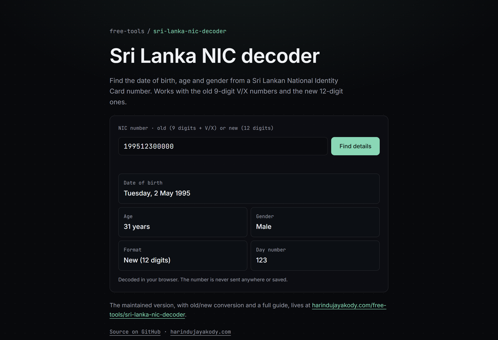

<div align="center">

# Sri Lanka NIC Decoder 🇱🇰

Find the date of birth, age and gender from a Sri Lankan National Identity Card (NIC) number. Works with old 9-digit V/X numbers and new 12-digit numbers, right in the browser.

[](https://harindujayakody.com/free-tools/sri-lanka-nic-decoder/)
[](https://harindujayakody.com/blog/sri-lanka-nic-number-explained/)
[](LICENSE)
[](script.js)
[](#tech-stack)
[](#privacy)
[](https://github.com/harindujayakody/nic-information-finder/stargazers)

**[Open the live tool](https://harindujayakody.com/free-tools/sri-lanka-nic-decoder/)** · [Read how NIC numbers work](https://harindujayakody.com/blog/sri-lanka-nic-number-explained/) · [GitHub Pages copy](https://harindujayakody.github.io/nic-information-finder/)



<sub>The number in the screenshot is made up. Please don't post real NIC numbers in issues or pull requests.</sub>

</div>

## What it does

Type a NIC number and the decoder shows:

| Result | Example (made-up `199512300000`) |
|---|---|
| Date of birth, with the weekday | Tuesday, 2 May 1995 |
| Age today | 31 years |
| Gender | Male |
| Format | New (12 digits) |
| Day number | 123 |

It accepts spaces and lower-case letters, checks the number as you type, and explains what's wrong with an invalid one (wrong length, day out of range, or 29 February in a year that didn't have one).

The [version on harindujayakody.com](https://harindujayakody.com/free-tools/sri-lanka-nic-decoder/) also converts old numbers to the new format and back, and has a FAQ. This repository holds the original tool and the decoding logic with tests.

## How a NIC number is decoded

| Format | Layout | Example (made up) |
|---|---|---|
| Old, before 2016 | `YY` `DDD` `SSS` `C` + `V`/`X` | `95` `123` `000` `0` `V` |
| New, since 2016 | `YYYY` `DDD` `SSSS` `C` | `1995` `123` `0000` `0` |

- `YY` / `YYYY`: birth year. Old numbers are always 19YY.
- `DDD`: day of the year. Women have 500 added, so 623 means day 123, female.
- `SSS` / `SSSS`: serial number. `C`: check digit. Neither says anything about the holder.

The day of the year uses a fixed table where **February always has 29 days**, in every year. Day 60 is 29 February and day 61 is always 1 March. Decoders that use the normal calendar (for example `new Date(year, 0, day)` in JavaScript) show birthdays from March onward one day late for anyone born in a non-leap year. This tool walks the 29-day table instead:

```js
var NIC_MONTH_DAYS = [31, 29, 31, 30, 31, 30, 31, 31, 30, 31, 30, 31];
```

The [blog post](https://harindujayakody.com/blog/sri-lanka-nic-number-explained/) goes through each part, the leap-year rule and old-to-new conversion with worked examples.

## Privacy

Everything runs in your browser. The number isn't sent to a server, isn't stored in cookies or local storage, and there's no analytics. The only network requests are the page's own files and Google Fonts.

## Tech stack

- HTML5 and CSS (custom properties, `color-mix`, light and dark themes from `prefers-color-scheme`)
- Vanilla JavaScript, no framework and no jQuery
- Inter and JetBrains Mono fonts
- Node's built-in `assert` for tests
- Hosted on GitHub Pages

The design matches the free tools on [harindujayakody.com](https://harindujayakody.com/free-tools/).

## Project structure

```
index.html   page markup
style.css    theme tokens and layout
script.js    decodeNic() and ageOn(), plus the browser UI
test.js      tests for the decoding rules
img/         favicon and screenshot
```

`script.js` exports `decodeNic` and `ageOn` under Node, so you can reuse the logic:

```js
const { decodeNic } = require("./script.js");
decodeNic("951230000V");
// { year: 1995, month: 5, day: 2, gender: "Male", dayNumber: 123, format: "old" }
```

## Run it locally

```bash
git clone https://github.com/harindujayakody/nic-information-finder.git
cd nic-information-finder
# open index.html in a browser, or serve the folder:
npx serve .
```

Run the tests (Node 16 or newer):

```bash
node test.js
```

## Contributing

Issues and pull requests are welcome. When you report a wrong date, describe the year and day number (for example "born in 2009, day number 147") rather than posting a full NIC number. Tests should use made-up numbers with a `0000` serial, like the ones in `test.js`.

## Author

Made by [Harindu Jayakody](https://harindujayakody.com/). More free tools are at [harindujayakody.com/free-tools](https://harindujayakody.com/free-tools/).

If the tool helped you, a ⭐ on the repo helps other people find it.

## License

[GPL-3.0](LICENSE)
